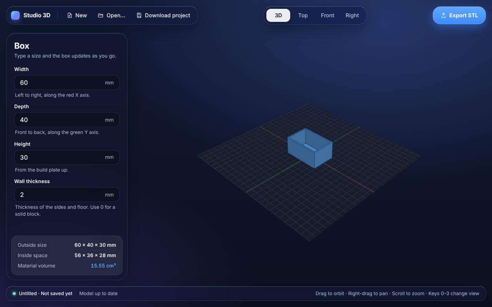

# Studio 3D

A beginner-first 3D design studio for making functional, dimensionally accurate parts for 3D printing. Windows desktop first; browser later.

## Status

| Milestone | State |
|---|---|
| 0. Audit and feasibility | Done. See [docs/milestone-0](docs/milestone-0/README.md) |
| 1. Running application | Done. App shell, 3D viewport, camera controls, tests, Windows CI |
| 2. Real geometry proof | **In review.** Real box from the OCCT kernel, save/reopen, verified STL export |
| 3. Guided "Make a Box" | Next |
| 4. Editing and operations | **In progress.** Holes, undo/redo, more shapes, sketching on faces and measurements are in review |

What works today:

- A tidy side panel: one toolbar of icons to add shapes, holes, sketches and edits; the steps of the part, one line
  each in build order; and the settings of just the step you're working on, with rarely needed ones under More.
  Help is in tooltips rather than paragraphs, and a step with a problem shows it on its line.
- A box with width, depth, height and wall thickness (0 = solid block, more = open-top container),
  built as a real solid by the OCCT geometry kernel in a background worker. The 3D view updates as you type.
- Plain-language errors for impossible values; the last valid box stays on screen and Export is disabled until fixed.
- Outside size, inside space and material volume, measured from the real geometry.
- New, Open, Save, Save as (Ctrl+N / Ctrl+O / Ctrl+S / Ctrl+Shift+S). Desktop saves are atomic and keep a `.bak`
  of the previous version. You're asked before unsaved changes are thrown away or the window closes.
- Crash recovery: while you have unsaved changes, a backup copy is kept a couple of seconds after each edit (on
  Windows in the app's data folder, in the browser build in local storage). If Studio 3D closes without saving, the
  next start offers to restore it. Saving, or choosing to close without saving, removes the backup.
- Shapes: box, cylinder, tube, cone and sphere, each placed anywhere on the plate and set to add material or cut it
  away. Every shape and every add or cut is checked against the exact maths, and impossible results keep your last good part.
- Holes: add round holes that go straight down from the top, all the way through or to a set depth. Each cut is
  checked against the hand calculation, holes that run off an edge are explained, and a hole that cuts nothing gets a warning.
- Sketches: click any flat face of the part (or draw on the plate) and draw rectangles, circles or any outline on it,
  with sizes and distances from the face's edges shown as you draw and exact numbers to type. Like AutoCAD's dynamic
  input, you can type sizes while drawing: after the first click, type a circle's diameter, a rectangle's width
  (Tab) and height, or an outline side's length (Tab) and angle, and press Enter. Then push the drawing
  out of the face (a boss, a bracket) or cut it in (a pocket, a slot, a through hole). Outlines that cross themselves
  are refused with an explanation, and every push or cut is checked against its area times its depth.
- Offsets: make a copy of any sketched shape grown or shrunk by an exact distance on every side. A shape drawn inside
  another becomes a hole, so an outline plus a smaller offset copy makes a frame, a rim or a washer.
- Hollow: empty out the whole part, leaving walls of the thickness you choose, open on one side (top, bottom, front,
  back, left or right) or closed with an empty space inside. The outside size is checked to stay the same and the
  material to go down. Walls too thick for the part, a side that isn't flat, and shapes the geometry engine can't
  hollow (like a cone's sharp tip) are explained, and your last good version is kept.
- Fillets and chamfers: round or bevel the part's edges by an exact size: every edge, the upright edges, the top
  edges or the bottom edges (a small bottom chamfer stops the first layer squashing out). The edges are chosen by
  rule, so they stay right when the part changes. Rounded boxes, corners and rings are checked against the exact
  volume, and a size too big for the part is explained while your last good version is kept.
- Patterns and mirrors: repeat a shape, hole or sketch in a row, a grid or round a circle (bolt holes, feet, ribs),
  or mirror it to the other side. Copies follow the original when it changes, and go with it if it's removed.
  Hole grids, bolt circles and mirrored bosses are checked against their exact volumes.
- Revolve: draw half of a round part's outline beside a spin line and spin it round, all the way or part way, like a
  part on a lathe (knobs, vases, pulleys, spacers). It can add material or cut it (a countersink, a round groove).
  Tubes, cones, rings and grooved pulleys are checked against their exact volumes (Pappus's theorem).
- Threads: give a cylinder or a hole a real thread: ISO metric coarse (M3 to M20), the ISO fine pitches two sources
  agree on, and inch UNC and UNF (#4 to 1/2"). A cylinder that adds becomes a
  threaded rod; a hole, or a cylinder that cuts, becomes a threaded hole a bolt screws into. A fit clearance (0.3 mm by
  default) leaves room so printed threads turn, and a test screws a printed-size bolt into its hole to check they
  never touch. Every thread's volume is checked against the exact ISO maths.
- Select and move: click any piece of the part (a shape, hole, sketch or hollow) to select it. It lights up, its
  settings open in the panel, and the clicked face is named, with a button to sketch on it. Drag the coloured arrows to
  move it (whole millimetres, or tenths with Shift), nudge it with the arrow keys and Page Up / Page Down, or remove it
  with Delete. Any shape can be removed, including the one the part started from; with everything removed the plate
  is empty and you can start a new part. Every face of the finished part is traced back to the step that made it, by checking it lies exactly on
  that step's own solid.
- Measurements in the 3D view: the part's width, depth and height are labelled, and the shape or hole you're editing
  shows its size and its distance from the part's edges. The status bar shows exactly where the pointer is on the part.
  The Sizes button (or M) turns the labels off and on.
- Undo and redo (Ctrl+Z, Ctrl+Y) for every change. Typing a number counts as one step.
- Export STL for your slicer. Tests check every exported mesh is watertight with exact dimensions, independently with trimesh.
- 3D view of a 256 × 256 mm build plate with all six standard views and iso (keys 0–3, Shift+1–3 for bottom, back
  and left). Ortho (key 5) switches to a true orthographic view, where parallel edges stay parallel, and keeps the
  part the same size on screen. Mouse controls work like Civil 3D and AutoCAD: hold the wheel and drag to pan,
  Shift + wheel-drag to orbit, scroll to zoom in where the pointer is, and double-click the wheel to fit everything on
  screen. Left-drag also orbits and right-drag pans. On the sketch screen, wheel-drag and right-drag only slide the
  drawing; it never turns.
- Precise outlines, AutoCAD style: type a corner as `x,y`, `@dx,dy` or `@length<angle`, or a length and angle in the
  boxes at the pointer. F8 locks sides straight across or up, angle steps (15°, 30°, 45°, 90°) click sides to those
  angles, and the pointer snaps to ends, middles, circle centres, crossings and square to a side (Alt ignores
  snaps). A drawn outline lists its sides: change one side's length or angle and the sides after it follow.
- Holes on any flat face (Create > Hole on a face…, or "Put on a face…" on a hole): drilled square into the face and
  placed by distances from its left or right edge and its bottom or top edge (or the middle). Switching which edge a
  distance is measured from keeps the hole where it is. On a side of a box the hole follows the box when it is
  resized or moved. A hole that would run off its face names the edge; nothing is moved to make it fit.
- Screw holes: a clearance hole for an M3 to M20 screw (ISO 273 close, normal or loose), with a counterbore for a
  socket head cap screw or a 90° countersink for a flat head screw, pre-sized for the screw and editable. A threaded
  hole can be threaded part way down, and can be simplified to its tap drill instead of modelling the thread. Every
  size comes from a published table; the sources are listed in `packages/document/src/threads.ts`.
- Reference pictures (Create > Reference picture…): put a photo or drawing in the scene to model over, lying on
  the plate or standing facing the front or right. Calibrate it by clicking two points a known distance apart and
  typing that distance (or type its real width), then move, turn or fade it. A sketch facing the same way shows the
  picture underneath at its real size, to trace over. Pictures are saved in the project but never built or exported:
  a test checks the STL is byte for byte the same with one.
- Screen modes (buttons at the right of the status bar, or the View menu): Full screen (F11) covers the whole screen
  with no title bar; Focus canvas (Ctrl+0, like AutoCAD's Clean Screen) puts the menus, side panel and status bar
  away, keeping the camera views, and brings the panel back while a piece is selected; Ctrl+B hides or shows the
  side panel on its own. Esc leaves either mode once it has nothing else to do. Nothing in the design, selection,
  camera or sketch changes.
- Print Studio (the Design | Print Studio switch at the left of the menu bar, or File > Prepare to print…): pick
  your printer (41 popular models from Bambu Lab, Prusa, Creality, Elegoo, Anycubic, Sovol, QIDI and Flashforge;
  build volume, nozzle and temperature limits only from the makers' own pages, never from slicer profiles) and see
  the part on its plate inside the build volume. Checks run on the exact STL that would go to your slicer: closed
  surface, one piece, fits the printer, sits on the plate. Each says what to do when it isn't fine. The printer is
  saved with the project but beside the design, so changing it never rebuilds the part. Export STL is here (and in
  the File menu).
- Open in your slicer: Print Studio finds Bambu Studio, OrcaSlicer and PrusaSlicer where their installers put them
  (or you locate any slicer's program once) and opens the checked part in it as a 3MF file. The slicer runs as its own
  program; nothing of it is built into Studio 3D. Export 3MF saves the same file: in millimetres, named after the
  project, and placed in the middle of the chosen printer's plate. Only the part's shape is sure to go across, so pick
  your printer, filament and settings in the slicer. Tests check the 3MF independently with trimesh.
- Studio 3D's own slicer, step one (written for Studio 3D, no other slicer's code): Preview layers cuts the checked
  part into its printed layers at the chosen layer height (0.08 to 0.28 mm, saved beside the design) and shows them
  on the plate, with a slider to go up and down through them. Each layer's area is checked against the exact cross
  section of boxes, containers, cylinders, spheres and holed blocks, and a gap in the surface is reported.
- Walls: each layer gets the chosen number of walls (1 to 4), 0.42 mm lines one inside the next, with the outside of
  the first line exactly on the part's surface. Walls are found by Studio 3D's own polygon offsetting (inside corners
  round, specks too small for a line left out), tested against hand-calculated areas. Places thinner than one line,
  which can't print, are listed by layer. Slicing runs in the background so the window stays responsive.
- Skins and infill: inside the walls, the bottom 0.6 mm and top 0.8 mm of the part (and over or under any step) are
  filled solid, and the rest with infill lines at the chosen density (0 to 100%, saved beside the design), crossing at
  right angles from one layer to the next. Our own area operations (overlap, take away) find where the part carries
  on above and below. Filled solid, the lines put down the part's own volume to within 3%.
- G-code from Studio 3D's own slicer (Print Studio > Preview layers > Export G-code…): plain Marlin-style G-code for
  PLA with our own start and end code, inner walls first, then the outside wall, then the fill. Before it's saved the
  file is read back move by move: every line of plastic must sit inside the part at a real layer's height, every move
  inside the printer, the filament must match the toolpaths, and the heaters must be off at the end. A second,
  separate reader (`scripts/verify_gcode.py`) checks the files the tests write. Bambu printers need G-code inside
  Bambu's own 3MF, which isn't written yet. Not yet tried on a real printer.
- A menu bar like other desktop CAD apps: File, Edit, View, Create, Modify and Help, each item with its shortcut.
  Alt (or Alt + a menu's first letter) reaches it from the keyboard. Items that can't run right now are greyed out
  with the reason. Help lists every keyboard and mouse control. Common commands also sit on a small quick-access bar.
- A clean frosted-glass interface: the 3D view fills the window and the controls float over it. Text contrast is
  checked by a test, and the app respects Windows' reduced motion, reduced transparency and high contrast settings.



Not yet: G-code for Bambu printers, material and speed settings, supports, and more than one part on the plate.

## Getting the Windows app (no setup needed)

1. Open the repository's **Actions** tab on GitHub and click the latest green **CI** run.
2. Under **Artifacts**, download `studio-3d-windows-installer` and unzip it.
3. Run the `*-setup.exe` file. Windows SmartScreen may warn because the app isn't code-signed yet. Click **More info → Run anyway**.

## Developer setup

You need Node 22, plus Rust and the Tauri prerequisites for the desktop app. Full Windows steps are in [docs/milestone-0/setup-instructions.md](docs/milestone-0/setup-instructions.md), Part B.

```bash
npm ci
npm run dev             # interface only, in your browser at http://localhost:1420
npm run desktop:dev     # the real desktop window (needs Rust + Tauri prerequisites)
npm run desktop:build   # Windows installers in apps/desktop/src-tauri/target/release/bundle
```

## Checks

```bash
npm run typecheck   # TypeScript
npm test            # unit tests (Vitest)
npm run build && npm run test:e2e   # browser tests (Playwright, Chromium)
python3 -I scripts/verify_stl.py test-output   # independent STL check of files the tests exported (needs trimesh)
cargo test --manifest-path apps/desktop/src-tauri/Cargo.toml   # safe file write tests
npm run licenses    # fails on copyleft/unknown licences; regenerates THIRD_PARTY_NOTICES.md
```

CI runs the TypeScript, browser, STL and licence checks on Linux. On a Windows machine it runs the Rust file-write tests, builds the installers, launches the app and checks the interface loads.

## Layout

```
apps/desktop/        React interface, file platform (desktop/browser), Tauri desktop shell (src-tauri/)
packages/document/   the project document, validation rules, .s3d file format and migrations
packages/geometry/   OCCT kernel adapter, background worker, result checks, STL export
packages/viewport/   Three.js view and camera controls (display only, never changes geometry)
scripts/             licence check and notices generator
docs/                milestone reports and decisions
```

Later milestones add `features`, `history`, `io`, `validation`, `print-prep` and `integrations`, as described in [docs/milestone-0/architecture.md](docs/milestone-0/architecture.md).
